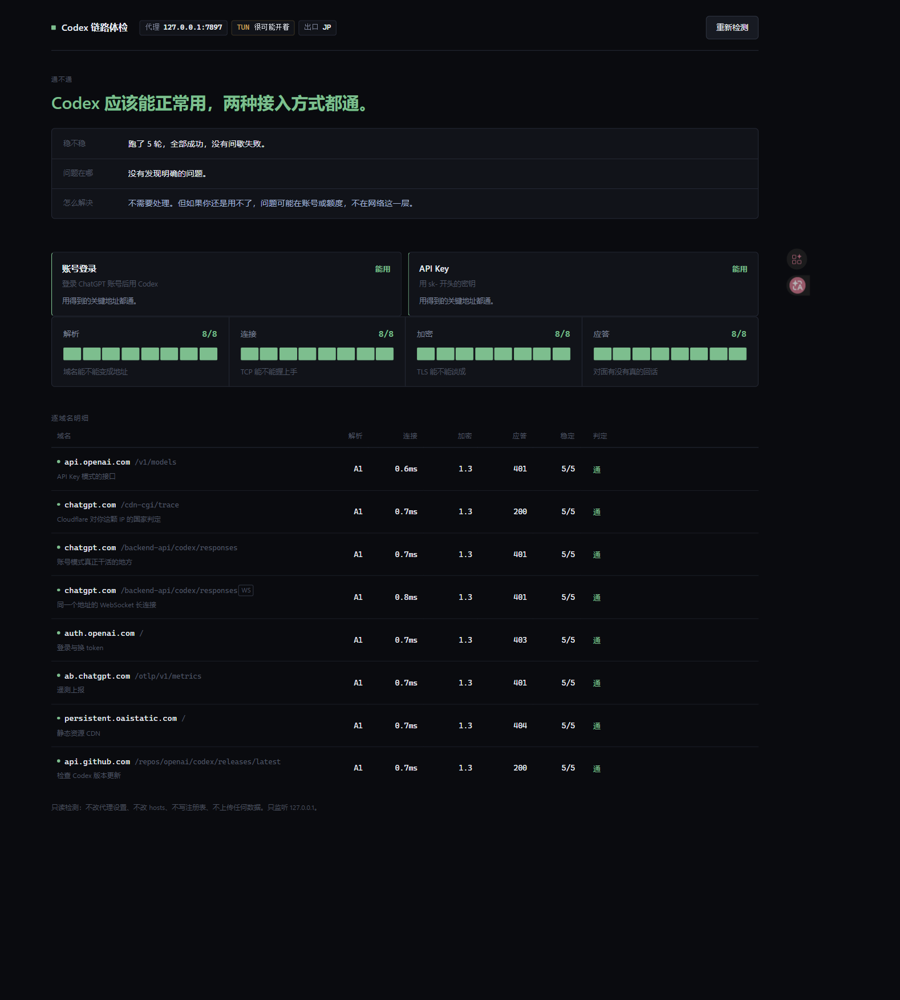

# codex-net-doctor

一句话：**Codex 报 `unsupported_country_region_territory` 或者连不上，跑它一次，看是哪一段出的问题。**

不需要安装任何依赖，有 Python 就能跑。

---

## 这是什么

一个本地小工具。它站在你这台电脑上，把 Codex 真正会去连的那几个域名挨个连一遍，然后告诉你：

- 请求到底从哪个 IP 出去了，被判定成哪个国家
- 每个域名是通了、被地区拦了、还是根本连不上
- 域名有没有被解析到奇怪的地址（说明被本机某层接管了）
- 有没有 TUN、有没有环境变量代理

跑完你会看到一句结论，比如：

> 出口 IP 被判成不支持的地区，这是报错的直接原因。

而不是一句干巴巴的「网络错误」。

## 为什么做它

`unsupported_country_region_territory` 这个报错看起来像网络故障，其实只有一个原因：**OpenAI 认为你请求的出口 IP 在不提供服务的国家/地区**。

问题是这个「出口 IP」一路上被改了好几次身份：

```
你的 Codex → 本机代理端口 → 境外节点 → OpenAI 看到的那个 IP
```

任何一环出岔子，最后一环就不对。而常见原因长得都不一样：

- 分流规则漏了某个域名，`chatgpt.com` 走了代理，`api.openai.com` 走了直连
- 开着 TUN 但规则没覆盖 WebSocket
- 本机 DNS 被改过，域名解析到了奇怪地址
- 环境变量里没配代理，Codex 压根没走代理

这四种情况表现出来的症状完全一样，靠猜要猜很久。现有的一批开源检测脚本（`RegionRestrictionCheck`、`IPQuality` 等）是给服务器和 VPS 用的，它们回答「这台机器的 IP 干净吗」，不回答「我这台电脑上为什么连不上」。

这个工具补的就是这一格。

## 怎么用

### 界面模式（推荐）

双击 `start.bat`。或者在终端里：

```
py run.py
```

会自动打开浏览器，地址是 `http://127.0.0.1:8787/`。第一次检测大概半分钟，因为要跑五轮看稳定性。

> **重要：一定要自己在终端或双击 start.bat 启动。** 如果由别的程序代你启动，那个进程可能继承了别的网络环境，测出来的不是你机器的结果。



页面从上到下四块：一句结论、四段链路、逐域名明细、需要处理的事。明细表从左往右找第一个空格，那就是断在哪一段。

### 命令行模式

```
py run.py --cli
```

不开浏览器，直接在终端把结果打出来。

### 换端口

```
py run.py --port 9000
```

### 改采样轮数

每次检测会把八个地址连跑五轮，用来判断稳不稳定，所以大约要半分钟。页面上会显示「正在跑第 N/5 轮」，不会看起来像卡死。

嫌慢可以减轮数：

```
py run.py --rounds 1
```

只跑一轮会快很多，但就看出不「间歇失败」这类问题了。

### 跑测试

```
py -m unittest discover -s tests
```

---

## 它检查什么

| 域名 | 作用 | 不通会怎样 |
|---|---|---|
| `api.openai.com` | API Key 模式的接口 | 用 Key 登录的 Codex 直接不可用 |
| `chatgpt.com` | Cloudflare 给你的地区判定 | 拿不到地区旁证 |
| `chatgpt.com/backend-api/codex/responses` | 账号模式真正干活的地方 | 每一轮对话都失败 |
| `chatgpt.com/backend-api/codex/responses`（WebSocket） | 同一个地址的长连接 | 能登录、能聊，但 Codex 跑一阵就断 |
| `auth.openai.com` | 登录与换 token | 登不进去 |
| `ab.chatgpt.com` | 遥测上报 | 不影响使用 |
| `persistent.oaistatic.com` | 静态资源 CDN | 不影响 CLI |
| `api.github.com` | 检查版本更新 | 只影响更新提示 |

每一行下面那行小字就是它的作用，界面上也有。

这些地址是从 `openai/codex` 上游源码核对出来的，不是猜的。依据见 `docs/design.md`。

## 结果怎么读

页面顶部直接回答四件事，不用自己拼：

| | 意思 |
|---|---|
| **通不通** | 最关键的那个答案，一行字说清现在能不能用 |
| **稳不稳** | 三轮里有没有间歇失败；跑一轮时会明确告诉你判断不了 |
| **问题在哪** | 最要紧的那个问题的具体来源 |
| **怎么解决** | 对应那条问题该动什么 |

四问下面是四段链路和逐域名明细，想看细节再看。

### 先看那两张卡片：你到底还能不能用 Codex

大字下面有两个小卡，分别对应 Codex 的两种接入方式：

| | 靠哪个地址 | 怎么判断 |
|---|---|---|
| **账号登录** | `chatgpt.com/backend-api/codex/responses` 和 `auth.openai.com` | 两个都通才算能用 |
| **API Key** | `api.openai.com/v1/models` | 通就能用 |

写「用不了」的时候，下面会直接说卡在哪个地址。这比“4 个检查项走不通”好懂得多——你要的不是检查项，是“我还能不能干活”。

**先看状态码，不要先看国家码。**

不带凭据请求 `api.openai.com/v1/models`，两种结果的含义完全不同：

- 返回 **401**：出口地区没问题，只是你没给 token。网络这一层是通的。
- 返回 **403** 且内容里有 `unsupported_country`：这才是地区被拒，也就是你看到的那个报错。

所以看到 401 请放心，那不是错误。工具会自动区分这两者，不会把 401 当成问题报给你。

**国家码（`loc`）只是旁证。** 它来自 Cloudflare 的边缘判定，跟 OpenAI 自己的判定通常一致，但不保证。最终以接口返回码为准。

**稳定列怎么看。** `5/5` 是五轮都通，`0/5` 是一次都没通，`3/5` 是时好时坏。碰到 `3/5` 这种，说明节点或线路在抖，而不是配置写错了。

**WebSocket 那一行为什么单独列。** 它和上面的普通请求是同一个地址，只是换了协议。分流规则里常常只写了 `http`/`https`、漏了 `ws`/`wss`，这种情况下普通请求能通而 WebSocket 不通，症状就是「能登录、能聊，但 Codex 跑一阵就断」。工具会专门把这种情况指出来。

## 复制提示词给自己用

找到问题之后，界面会给你一个「复制排查提示词」按钮。点一下复制，然后粘给你自己的 agent（Codex、Claude Code 都行），它会拿着完整的现场信息去查。

提示词里已经写好了：

- 这是哪一次体检、结论是什么
- 具体断在哪个地址、原始错误是什么
- 这台机器的代理设置、TUN 状态、出口地址
- Codex 会连哪些地址（免得它重新摸索一遭）
- 这类问题该去查什么（比如断在连接就看分流规则，WebSocket 不通就看有没有漏写 ws）

最后是一段约束：**先只读排查，改配置前把要改的内容先给你看。** 这是故意的。网络配置改错了比不改更难排查，工具不替你做这个决定。

## 如果有问题怎么办

**页面打不开** → 端口被占了。换一个：`py run.py --port 9001`。

**所有域名都是「连不上」** → 先确认你现在的代理软件真的在跑。工具不会替你启动它。

**某一两个域名连不上，其余正常** → 这就是分流规则的问题。去你的代理软件里看这个域名命中了哪条规则，大概率是被分到了直连。

**显示「TUN 模式：没发现迹象」但你认为自己开着 TUN** → 这一项是推测，不是权威判定。它的依据是「有没有域名解析到 `198.18.x.x`」和「出口网卡地址像不像虚拟网卡」。两个线索都没出现时会显示「没发现迹象」，不影响其它检查结果。

**提示「解析到了非公网地址」** → 检查一下 `C:\Windows\System32\drivers\etc\hosts` 有没有被写过，以及代理软件的 DNS 设置。

## 它不会做什么

- 不改你的代理配置、不改 hosts、不写注册表
- 不上传任何数据，所有请求都从你本机直接发出
- 只监听 `127.0.0.1`，关掉程序页面就失效
- 不自动「修复」任何东西。诊断和修改分开，改错配置比不改更麻烦

## 目录

```
codex-net-doctor/
├── run.py                      入口，双击或 py run.py
├── src/netdoctor/
│   ├── envscan.py              读环境：代理变量、系统代理、出口网卡
│   ├── probe.py                域名表 + 单点探测 + 地址归类
│   ├── diagnose.py             把探测结果翻译成结论
│   ├── server.py               本地 HTTP 服务
│   └── ui/index.html           界面
├── tests/                      单元测试，不发真实请求
└── docs/                       设计依据与状态
```

## 许可

MIT，见 `LICENSE`。

## 术语

- **出口 IP**：请求最终到达 OpenAI 时，对方看到的那个 IP。不是你的家庭宽带 IP，是最后一跳节点的 IP。
- **分流规则**：代理软件里的判断逻辑，决定某个域名是走代理还是直连。
- **TUN 模式**：代理软件装一块虚拟网卡，把系统所有流量都接管过来。开了它，程序读不读代理环境变量都能出去。
- **fake-ip**：代理软件常用的一招，把域名解析成 `198.18.x.x` 这样的假地址，先骗过程序，等真正连接时再换成真地址。
- **DNS 泄漏**：本该走代理的域名，解析请求却直接发给了国内 DNS，导致拿到被污染的结果。
